<div align="center">
  

  <br />

[](https://vite.dev/)
[](https://threejs.org/)
[](https://gsap.com/)
[](#)

**A richly animated, responsive nightlife / events portfolio template.**  
 Built with vanilla JavaScript, Vite, Three.js and GSAP.

[Preview locally](#-quick-start) ·

</div>

---

## ✨ The experience

A long-form, editorial landing page for a fictional live-music gathering in Lahore. Deep espresso tones, champagne-gold details, serif display type, fine grain, a custom cursor, layered photography, and a metallic 3D mirror ball give it a late-night character.

> **A design study, not a copy of the source brand.** This template uses original text, generated photographs, a new fictional identity and its own implementation. Swap the sample venue, date, prices and contact details before publishing for real.

### What’s inside

- **Cinematic first visit** — a small percent-count loader and animated hero entrance.
- **Interactive mirror ball** — a Three.js tiled sphere that responds to pointer movement and tap/click.
- **Motion with restraint** — GSAP section reveals and hover cues; reduced-motion and Calm mode options.
- **Complete page flow** — intro, guest list, editions, story, photo flips, venue/map artwork, live countdown, FAQ, partners and footer.
- **Responsive navigation** — compact mobile menu, keyboard focus states, skip link and semantic page structure.
- **Useful details** — working calendar reminder, countdown, FAQ accordion, and mailto guest-list action.
- **Distinct generated imagery** — all three supplied event photos are in `assets/` and can be replaced.

## 🧰 Built with

| Tool                                      | Role                                         |
| ----------------------------------------- | -------------------------------------------- |
| [Vite](https://vite.dev/)                 | Local dev server and production bundler      |
| [Three.js](https://threejs.org/)          | 3D mirror-ball illustration                  |
| [GSAP](https://gsap.com/) + ScrollTrigger | Intro and scroll-triggered motion            |
| HTML + CSS + JavaScript                   | Layout, responsive behavior and interactions |

The reference website was served as a Vite-built static page and used Three.js / GSAP-style motion. This template follows that same broad frontend approach, but is independently implemented. It is not affiliated with the reference website.

## 🚀 Quick start

**Requirements:** Node.js 20.19+ or 22.12+ and npm.

1. Download or clone this repository.
2. Open a terminal in the project folder (the one containing `package.json`).
3. Install dependencies and start the preview:

```bash
npm install
npm run dev
```

4. Open the local URL Vite prints, usually **http://localhost:5173/**. Keep the terminal window open while previewing.
5. To check the real deploy build:

```bash
npm run build
npm run preview
```

Vite serves the project at a local preview address. If you are using an editor with a built-in terminal, open the project directory there and run the same commands.

## 🎨 Make it yours

| Change                                                     | Where to edit                                                                                        |
| ---------------------------------------------------------- | ---------------------------------------------------------------------------------------------------- |
| Name, navigation, page copy, links                         | `index.html`                                                                                         |
| Theme, layout, responsive rules and reduced-motion styling | `src/style.css`                                                                                      |
| Event date used by countdown                               | `data-date` on `[data-countdown]` in `index.html`                                                    |
| Calendar reminder                                          | The `data:text/calendar` URL on `.calendar-link` in `index.html`                                     |
| Guest list email                                           | `mailto:` links in `index.html`                                                                      |
| Photos                                                     | Replace `assets/crowd.jpg`, `assets/friends.jpg`, `assets/dance.jpg` (keep filenames or update HTML) |
| 3D object and interactions                                 | `src/main.js`                                                                                        |
| Browser tab icon                                           | `assets/favicon.svg`                                                                                 |

For the countdown, change both the date near the ticket section and the `data-date` value. Update the calendar URL too; it is URL-encoded iCalendar text. Replace fictional details such as **The Glasshouse**, prices and the example email before launch.

### Accessibility & motion

- The menu button updates `aria-expanded`; all menu links work with a keyboard.
- The photo cards flip on click/tap and expose an accessible label.
- Calm mode is remembered in the browser. Visitors can also use their operating-system reduced-motion setting.
- A pointer-following cursor is only enabled for fine pointers; touch screens use their normal cursor.

## 📁 Project structure

```text
friday-society-portfolio/
├── assets/
│   ├── crowd.jpg
│   ├── dance.jpg
│   ├── friends.jpg
│   ├── favicon.svg
│   └── readme-night.svg
├── src/
│   ├── main.js
│   └── style.css
├── .gitignore
├── index.html
├── package.json
├── package-lock.json       # created by npm install
```

## 📝 License & credits

This is a portfolio starter template. The sample identity and event details are fictional. Generated sample images are bundled locally. The source website's brand, copy, and photographs are not included. Review asset and dependency licenses before using the template commercially; dependencies are listed in `package.json`.

---

<div align="center">
  <sub>Designed for nights that run a little longer. ✳</sub>
</div>
